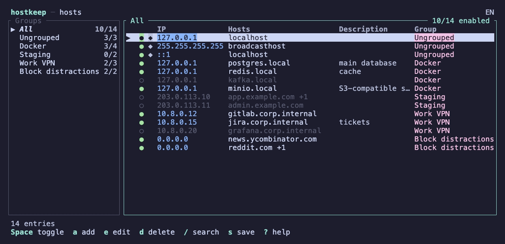

# hostkeep

[](https://github.com/volodymyr-malishevskyi/hostkeep/actions/workflows/ci.yml)
[](https://crates.io/crates/hostkeep)
[](#license)

**A terminal UI editor for `/etc/hosts` on macOS and Linux.** Enable and disable host entries with
one key, organize them into groups (Docker, VPN, staging, ad blocking…), and save safely with a diff
preview and automatic backups — without breaking the file's formatting.

A keyboard-driven hosts file manager for developers who switch local domains often and are tired of
`sudo vim /etc/hosts`.



## Features

- **Lossless editing.** Comments, blank lines, spacing and line order are kept; only the lines you
  change are rewritten.
- **Enable / disable** entries or whole groups with `Space` (a disabled entry is a commented-out line).
- **Groups** stored right in the hosts file as `# @group Name` … `# @end`, so they survive manual edits
  and other tools ignore them.
- **Search**, multi-select, duplicate, move between groups, reorder, undo/redo.
- **Validation** of IP addresses and host names, warnings for conflicting and duplicate entries.
- **Safe saving:** a diff before every save, an automatic backup, an atomic write, detection of
  changes made by other programs, restore from backups.
- **No need to run as root:** hostkeep asks for `sudo` only when saving.
- **DNS cache flush** after saving `/etc/hosts` (macOS, Linux with systemd-resolved).
- **English and Ukrainian** interface, switchable with `L`.

Platforms: macOS and Linux.

## Install

**Homebrew** (macOS and Linux):

```sh
brew install volodymyr-malishevskyi/tap/hostkeep
```

**Cargo:**

```sh
cargo install hostkeep
```

**Prebuilt binary** (installs to `~/.cargo/bin`):

```sh
curl --proto '=https' --tlsv1.2 -LsSf https://github.com/volodymyr-malishevskyi/hostkeep/releases/latest/download/hostkeep-installer.sh | sh
```

Or download an archive for your platform from [Releases](https://github.com/volodymyr-malishevskyi/hostkeep/releases).

**From source** (requires a [Rust toolchain](https://rustup.rs), edition 2024):

```sh
git clone https://github.com/volodymyr-malishevskyi/hostkeep
cd hostkeep
cargo install --path .
```

## Usage

```sh
hostkeep                    # edit /etc/hosts
hostkeep --file ./hosts     # edit another file (handy for trying things out on a copy)
hostkeep --lang uk          # force the interface language (uk or en)
```

Run it as your regular user. When the file is not writable, the header shows that `sudo` is needed;
on save hostkeep first tries `sudo -n` (silent if sudo still remembers your password) and otherwise
steps out of the UI for the usual `sudo` prompt. hostkeep never reads or stores the password itself.

### Keys

| Key | Action |
|---|---|
| `↑↓` / `j k` | move |
| `← →` / `h l`, `Tab` | switch panels |
| `Space` | enable / disable an entry or a group |
| `a` | add an entry (a group in the groups panel) |
| `e` / `Enter` | edit an entry, rename a group |
| `d` / `Del` | delete |
| `c` | duplicate |
| `m` | move to another group |
| `J` / `K`, `Shift+↑↓` | move down / up |
| `v` | select several entries |
| `/` | search |
| `u` / `Ctrl+r` | undo / redo |
| `s` / `Ctrl+s` | save (with a diff preview) |
| `r` | view the raw file |
| `b` | backups |
| `L` | switch language |
| `?` | help |
| `q` / `Esc` | quit |

In the entry form the hosts field lists one name per row: `↑↓` move between names, `Space` starts a
new one, `Alt+←→` jump by word.

## The hosts file format

hostkeep reads any regular hosts file. Groups are optional comment markers:

```
127.0.0.1       localhost

# @group Docker
127.0.0.1       postgres.local redis.local  # databases
# 127.0.0.1     kafka.local
# @end
```

- `# 127.0.0.1 kafka.local` is a disabled entry: a commented line that parses as `IP host…`.
  Other comments stay comments.
- The trailing `# databases` is shown as the entry's description.
- Entries outside groups appear under "Ungrouped".
- System entries (`localhost`, `broadcasthost`, …) are marked `◆` and ask for confirmation before
  they are disabled or deleted.

## Configuration

`~/.config/hostkeep/config.toml` (or `$XDG_CONFIG_HOME/hostkeep/config.toml`), all keys optional:

```toml
hosts_path = "/etc/hosts"   # file to edit when --file is not given
backups_keep = 20           # how many backups to keep
flush_dns = true            # flush the DNS cache after saving /etc/hosts
language = "auto"           # auto, en or uk
```

With `language = "auto"` the language comes from `LC_ALL` / `LC_MESSAGES` / `LANG`, then the system
locale, then English.

Backups are kept in `~/.local/share/hostkeep/backups` (or `$XDG_DATA_HOME/hostkeep/backups`) as
`hosts-YYYYMMDD-HHMMSS`. When hostkeep runs under `sudo`, config and backups still belong to the real
user.

## Development

```sh
cargo test                     # unit tests, including byte-exact parser round-trips
cargo clippy --all-targets
cargo run -- --file /tmp/hosts-copy
```

Try changes on a copy (`--file`), not on the real `/etc/hosts`. Translations live in
`locales/<lang>/main.ftl` ([Fluent](https://projectfluent.org) format); a test checks that every
language has the same keys. The design and the decisions behind it are in [docs/SPEC.md](docs/SPEC.md).

## License

Licensed under either of [Apache License, Version 2.0](LICENSE-APACHE) or [MIT license](LICENSE-MIT)
at your option.

Unless you explicitly state otherwise, any contribution intentionally submitted for inclusion in
hostkeep by you, as defined in the Apache-2.0 license, shall be dual licensed as above, without any
additional terms or conditions.
